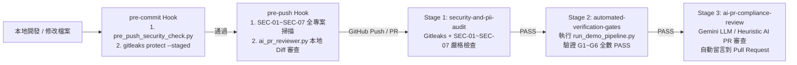

# CI/CD 與 Push 前自動 AI 安全檢查使用指南

本指南說明如何啟用本專題（`期未/`）內建的 **Push 前雙重自動防護（Pre-Commit / Pre-Push + AI Diff Reviewer）** 與 **GitHub Actions 三階段 CI/CD 自動檢查流程**，確保上傳至 GitHub 的每一筆 Commit 與 Pull Request 均符合個資去敏、零憑證外洩、版權合規與 `G1–G6` 演算法驗收標準。

---

## 一、雙層防線總覽（本地端 Push 前 + 雲端 GitHub Actions）



---

## 二、檔案清冊與角色說明

| 檔案路徑（相對於 `期未/`） | 用途與負責檢查項目 |
| :--- | :--- |
| [`.gitignore`](../.gitignore) | 自動阻擋 `.env`、Cookie/Session 狀態檔、`raw_unmasked/`、`.DS_Store`、含個人 Gemini 分享網址的參考 PDF、以及教科書版權檔案。 |
| [`.gitleaks.toml`](../.gitleaks.toml) | Gitleaks 機敏規則設定：除了內建 150+ API Token 規則外，另自訂 Gemini 個人連結、社群 Cookie、`SALT` 硬編碼、本機 `/Users/<name>/` 路徑與 Cambridge Core 版權浮水印偵測。 |
| [`.pre-commit-config.yaml`](../.pre-commit-config.yaml) | 標準 `pre-commit` 框架設定檔（整合 `check-added-large-files`、Gitleaks、本地安全掃描與 AI Diff 審查）。 |
| [`cicd_與_安全檢查範本/pre_push_security_check.py`](pre_push_security_check.py) | 零第三方相依的 Python 安全掃描器，檢查 `[SEC-01]` 至 `[SEC-07]` 七大規則，支援驗證 CSV/SQLite 欄位是否真為 16 位 hex SHA-256 雜湊與 PDF 內部文字掃描。 |
| [`cicd_與_安全檢查範本/ai_pr_reviewer.py`](ai_pr_reviewer.py) | AI PR / Push 審查腳本：若有設定 `GEMINI_API_KEY` 會呼叫 Gemini 審查爬取倫理、PII 設計與 HITS 邏輯；若離線或未設金鑰則自動啟用確定性啟發式審查（Offline Heuristic Fallback）。 |
| [`cicd_與_安全檢查範本/install_git_hooks.sh`](install_git_hooks.sh) | 零相依性安裝腳本：驗證工作目錄確實為 `期未/`（防止誤在父層含教科書目錄執行 `git init`），並寫入 `.git/hooks/pre-commit` 與 `.git/hooks/pre-push`。 |
| [`.github/workflows/ci_ai_security_and_gates.yml`](../.github/workflows/ci_ai_security_and_gates.yml) | GitHub Actions 三階段自動化 CI/CD 工作流，每次 Push / PR 自動執行安全審計、`G1–G6` 驗收與 PR AI 自動留言審查。 |

---

## 三、本地掃描七大規則 (`[SEC-01]` – `[SEC-07]`)

1. **`[SEC-01]` 金鑰與私鑰偵測**：偵測 Google/Gemini API Key、GitHub PAT、OpenAI/Anthropic Key、AWS Access Key 與 Private Key 區塊。
2. **`[SEC-02]` 社群登入 Cookie 與 Session 狀態**：偵測 `c_user=`、`xs=`、`sessionid=`、`Cookie:` 標頭，以及 `cookies.txt`、`auth_state.json`、`session.json`、`*unmasked*` 等檔案。
3. **`[SEC-03]` 個人 Gemini 分享網址**：偵測檔案（含 `.pdf` 內部串流與標註）中出現的個人對話連結 `https://gemini.google.com/app/...` 或 `/share/...`。
4. **`[SEC-04]` 版權教材外洩**：偵測 `Cambridge Core terms of use` 或 `Downloaded from https://www.cambridge.org/core` 等教科書下載浮水印，以及父層目錄風險警示。
5. **`[SEC-05]` 本機路徑與未去敏個資**：偵測硬編碼本機路徑（如 `/Users/<local_user>/`、`C:\Users\...\`）、CSV 內出現 Email / 手機號碼，或 CSV / SQLite 雜湊欄位出現非 16 碼 hex 值。
6. **`[SEC-06]` 硬編碼正式環境雜湊鹽值**：阻擋未經 `os.environ.get` 讀取、寫死正式 `privacy_salt` 的程式碼。
7. **`[SEC-07]` 系統垃圾檔與超限大檔**：阻擋 `.DS_Store`、`.env` 與超過 `5 MB` 的未切割二進位檔進入追蹤範圍。

---

## 四、上線前操作 SOP

### 步驟 1：僅在 `期未/` 內初始化 Git（切勿在上一層父目錄執行！）

```bash
cd "Networks, Crowds, and Markets/期未"
bash cicd_與_安全檢查範本/install_git_hooks.sh --init
```

> [!CAUTION]
> **切勿**在 `Networks, Crowds, and Markets/` 父目錄執行 `git init`，否則會涵蓋受版權保護的 `課本_pdf/` 與 `課本_文字/`。

### 步驟 2：手動執行 Push 前檢查與 AI 審查試跑

```bash
python3 cicd_與_安全檢查範本/pre_push_security_check.py --strict-ci
python3 cicd_與_安全檢查範本/ai_pr_reviewer.py --diff-mode workspace --strict
```

### 步驟 3：若團隊使用標準 `pre-commit` CLI（可選）

```bash
pip install pre-commit
pre-commit install --hook-type pre-commit --hook-type pre-push
pre-commit run --all-files --hook-stage manual
```

### 步驟 4：GitHub Repository Secrets 設定（建議）

若希望 Stage 3 在 Pull Request 上啟用線上 LLM 語意審查，請至 GitHub Repo 的 **Settings → Secrets and variables → Actions** 新增：

- `GEMINI_API_KEY`：用於 `ai-pr-compliance-review` 呼叫 Gemini API 進行差量語意審查（若未設定，CI 仍會自動使用 Offline Heuristic Fallback 運作，不會中斷流程）。
- `TAIGI_PII_SALT`（選用）：正式研究階段部署於 CI 驗證時注入獨立鹽值；未設定時 CI 會使用臨時測試鹽 `ci_ephemeral_benchmark_salt`。
