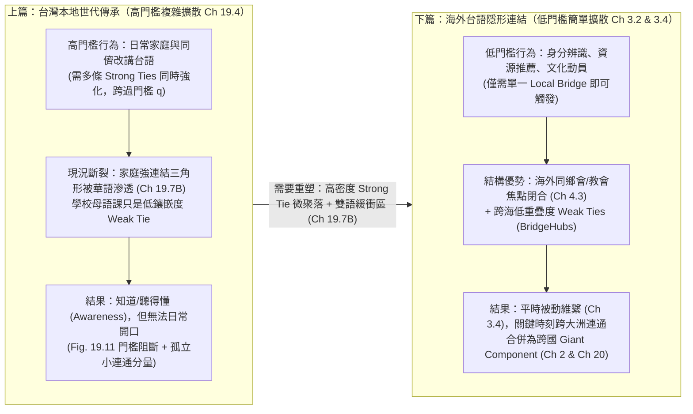
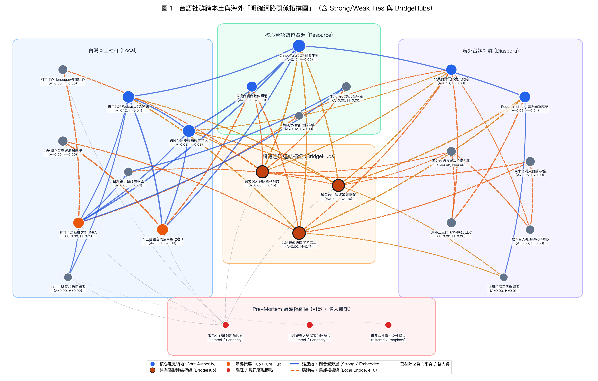
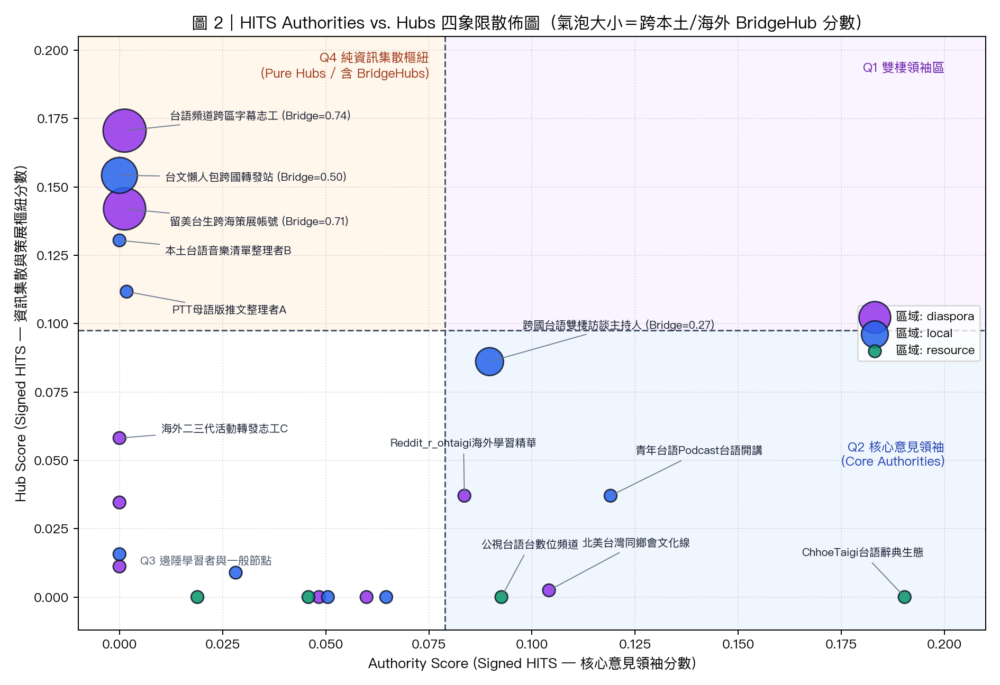
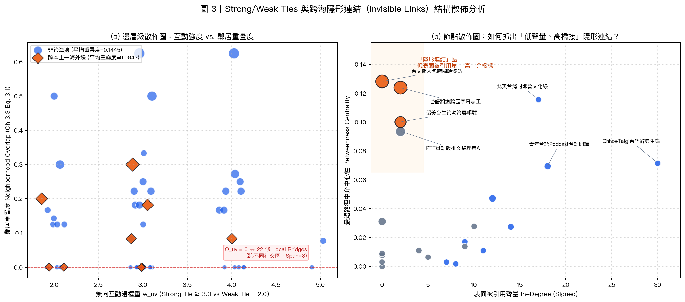
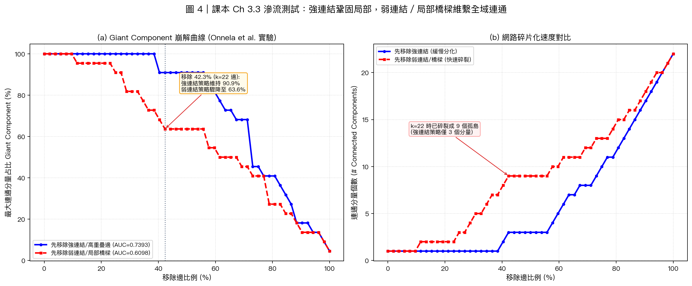
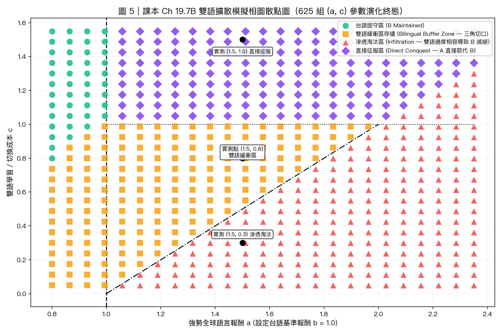

# 第六章：圖論（Graph Theory）與強弱連結（Strong & Weak Ties）深度解析

> **對應課本**：
> - [`課本_文字/02_Graphs.md`](../../../課本_文字/02_Graphs.md)（Ch 2 Graphs, pp. 21–42）
> - [`課本_文字/03_Strong_and_Weak_Ties.md`](../../../課本_文字/03_Strong_and_Weak_Ties.md)（Ch 3 Strong and Weak Ties, pp. 43–76）
> - [`課本_文字/19_Cascading_Behavior_in_Networks.md`](../../../課本_文字/19_Cascading_Behavior_in_Networks.md)（Ch 19.4 Diffusion, Thresholds, and the Role of Weak Ties, pp. 509–512）

本章直接以**圖論（Graph Theory）**與**強弱連結理論（Strength of Weak Ties + Complex Contagion）**，將題目 **「台語：從世代傳承的困境，到海外社群的隱形連結」** 轉譯為嚴謹的網路拓撲語言與可計算指標。

---

## 一、基礎圖論語言如何表達「台語傳承困境」與「海外隱形連結」？（對應課本 Ch 2）

### 1.1 兩種圖結構的雙重視角（Ch 2.1, pp. 21–24）
1. **日常溝通無向圖 $G = (V, E)$**：
   - 節點 $v \in V$：代表個人、家庭、台語教會或線上社群成員。
   - 無向邊 $(u, v) \in E$：代表兩人／兩單位之間存在**雙向台語互動或互助關係**，邊權重 $w_{uv}$ 反映互動頻率與親密深度（區分 Strong Tie 與 Weak Tie）。
2. **資源引用與推薦有向圖 $G_{\text{dir}} = (V, E_{\text{dir}})$**：
   - 有向邊 $u \to v$：代表節點 $u$（Hub）推薦、引用或向節點 $v$（Authority）學習／取經（對應 Ch 14 Hubs & Authorities）。

### 1.2 路徑、環（Cycles）、三元閉合與連通分量（Ch 2.2–2.3 & Ch 3.1）
- **環（Cycle）與三元閉合（Triadic Closure, Ch 2.2 p. 25 & Ch 3.1 p. 44）**：  
  在圖論中，長度為 $3$ 的環（Triangle）代表 $A-B-C$ 彼此皆以台語互動（例如「阿公—爸爸—孫子」或「同鄉會成員 A—B—C」）。高密度三角形形成**高群聚係數（Clustering Coefficient $C_i$）**與安全冗餘，使母語即使在單一節點缺席時仍可透過「三角形的另一條邊」獲得維持。
- **廣度優先搜尋（BFS）與路徑距離 $d(u, v)$（Ch 2.3, pp. 29–35）**：  
  度量一位在美國中西部或歐洲的台裔二代（Periphery），需要經過幾跳（Hops）才能接觸到 ChhoeTaigi 辭典或本土台語社群的核心資源。
- **連通分量（Connected Components）與巨型連通分量（Giant Component, Ch 2.2 pp. 25–29, Fig. 2.5）**：  
  - **本土世代斷層的圖論本質**：當年輕世代與長輩之間不再用台語建立互動邊（$w_{uv} \to 0$），原本覆蓋全家族／社區的單一 **Giant Component** 會斷裂成大量僅剩高齡母語者的「**孤立小連通分量（Isolated Small Components）**」，即使總節點數仍大，但跨世代已無法傳遞。
  - **海外隱形連結的圖論本質**：散居洛杉磯、紐約、東京、倫敦的小型台灣聚落各自形成緊密的小型連通分量；只要存在少數跨國橋樑邊（Bridges / Local Bridges），這些孤島在全域圖論尺度上即合併成一個橫跨各大洲的 **Giant Component**。

---

## 二、Strong Ties + Weak Ties 的核心數學指標與定理（對應課本 Ch 3）

### 2.1 強連結 vs. 弱連結、鑲嵌度與鄰居重疊度（Ch 3.2–3.5, pp. 46–61）

對無向圖 $G = (V, E)$ 中的任一條邊 $e = (u, v)$，令 $N(u)$ 為節點 $u$ 的鄰居集合，定義課本兩大結構指標：

1. **鑲嵌度（Embeddedness, Ch 3.5 p. 58）**：邊 $e = (u, v)$ 兩端點所擁有的共同朋友數量：
   $$e_{uv} = |N(u) \cap N(v)|$$
2. **鄰居重疊度（Neighborhood Overlap, Ch 3.3 Eq. 3.1, p. 52）**：衡量兩端點社交圈的重疊比例（分母扣除 $u, v$ 本身）：
   $$O_{uv} = \frac{|N(u) \cap N(v)|}{|(N(u) \cup N(v)) \setminus \{u, v\}|} \in [0, 1]$$

兩類連結在結構與功能上的精準對比如下：

- **強連結（Strong Ties）**：互動頻率高、邊權重 $w_{uv}$ 高（如家人、同班死黨、固定台語共學夥伴）。因頻繁互動帶來機會與信任，使周圍不斷發生 **Triadic Closure**，故強連結通常具有**高鑲嵌度（$e_{uv} \ge 1$）與高鄰居重疊度（$O_{uv} > 0$）**。其核心價值是提供**高度信任（Trust）、社會規範約束（Sanctions）與反覆確認**（對應 Ch 3.5 Fig. 3.11 節點 A）。
- **弱連結（Weak Ties）**：互動頻率較低、邊權重 $w_{uv}$ 較低（如海外偶爾聯繫的校友、跨界轉發的社群志工、不同城市同鄉會聯絡人）。雖然親密度不如強連結，卻經常具有**極低或為零的鄰居重疊度（$O_{uv} \approx 0$）**，能跨越**結構洞（Structural Holes, Burt `[86]`）**帶來圈外的新資訊與新資源（對應 Ch 3.5 Fig. 3.11 節點 B）。

### 2.2 橋樑、局部橋樑與強三元閉合性質（STCP 定理, Ch 3.2 pp. 46–50）

1. **橋樑（Bridge, Fig. 3.3）**：移除邊 $e = (u, v)$ 後，$u$ 與 $v$ 落入不同的連通分量（移除後距離 $\text{Span} = \infty$）。
2. **局部橋樑（Local Bridge, Fig. 3.4）與跨距（Span）**：$u$ 與 $v$ 沒有任何共同鄰居（$e_{uv} = 0 \iff O_{uv} = 0$），且移除邊 $e$ 後，$u$ 與 $v$ 在剩餘圖 $G \setminus \{e\}$ 中的最短距離（**Span**）嚴格大於 $2$（$\text{Span}(e) = d_{G \setminus \{e\}}(u, v) \ge 3$）。
3. **強三元閉合性質（Strong Triadic Closure Property, STCP）**：若節點 $A$ 與 $B, C$ 皆為強連結，則 $B$ 與 $C$ 之間必至少存在一條邊（強或弱）。
4. **課本核心定理（p. 49 Claim & Fig. 3.6 反證法）**：  
   > **若節點 $A$ 滿足 STCP 且擁有至少兩條強連結，則 $A$ 所參與的任何局部橋樑（Local Bridge）必然是弱連結（Weak Tie）！**  
   *反證法解析*：假設局部橋樑 $A-B$ 是強連結，且 $A$ 另有另一條強連結 $A-C$；根據 STCP，$B$ 與 $C$ 之間必有邊相連，這使得 $A$ 與 $B$ 擁有共同鄰居 $C$（$e_{AB} \ge 1$），直接矛盾於「局部橋樑無共同鄰居」的定義！  
   - **對本專題的啟示**：**為什麼幫海外台灣人快速找工作、租屋或串聯跨國台語資源的「隱形連結」幾乎都是弱連結？** 因為若兩地節點是每天密切聯繫的強連結，STCP 早就讓雙方朋友圈高度重疊（$O_{uv}$ 變高），反而失去跨圈層傳遞稀缺資源的橋樑角色！

### 2.3 Onnela et al. `[334]` 巨型連通分量滲流拆解（Ch 3.3 pp. 52–53）

Onnela 等人在大型電信社交網路中驗證了一個深刻結構性質（課本 p. 53）：
- **先移除最強連結**：Giant Component 僅緩慢、線性縮減（因為強連結位於高密度三角形聚落內部，拿掉一條還有另外兩條三角形邊繞過去）。
- **先移除最弱連結／低 $O_{uv}$ 局部橋樑**：Giant Component 會在越過臨界數量後**瞬間碎裂（Abrupt Fragmentation）**，原本連通的大社群立刻崩解為互不相連的孤島！
- **這解釋了海外台灣社群的結構脆弱性**：只要把少數幾位低調的跨海弱連結志工（我們的 `BridgeHub` 節點）從網路中拿掉，台北、北美、日本、歐洲的台語聚落瞬間失去連通路徑。

### 2.4 社群媒體與「被動維繫網路」（Passive Engagement, Ch 3.4 pp. 54–58）

Marlow et al. `[286]`（Fig. 3.8–3.9）與 Huberman et al. `[222]`（Fig. 3.10）指出：由於人類每日時間有限，**雙向強連結（Reciprocal Strong Ties）數量有生理上限（僅約 $10\sim 20$ 人）**；但社群媒體的 News Feed、訂閱與追蹤機制，創造出介於強弱之間的 **Maintained / Passive Engagement（被動關注網路）**——讓人可以低成本維繫數百個不常私訊但持續看見動態的弱連結。這正是海外社群「平時看似安靜隱形、有事或有台語共鳴話題卻能一呼百諾」的技術基礎。

---

## 三、核心整合解析：強弱連結的「雙刃劍效應」（Ch 3.2 vs. Ch 19.4）

將課本 **Ch 3（Weak Ties 的優勢）** 與 **Ch 19.4（Centola & Macy `[101]` 複雜擴散門檻，pp. 509–512, Fig. 19.11）** 並置，就能得出貫穿本專題前後兩篇的最核心圖論診斷：

### 雙軸命題的圖論終極解答

1. **為什麼台灣本土「聽得懂卻講不出口 / 世代斷層」？**  
   因為「把一種語言當作日常交流媒介」屬於 **High-Threshold Complex Contagion（高門檻複雜擴散，Ch 19.4）**。在學校每週一堂母語課、或偶爾聽到電視台語新聞，在圖論上都只是 **低鑲嵌度的單一弱連結（Weak Tie / Local Bridge）**——它們足以傳遞「意識（Awareness：知道阿公講什麼）」，卻不足以推動「高成本行為採納（Adoption：自己在同儕間開口說台語）」。真正能守住開口門檻的，必須是家庭與生活圈內 **高鑲嵌度（$e_{uv} \ge 1$）、高群聚（High Clustering）的強連結三角形（Strong Ties）**，配合 **Ch 19.7B 的雙語緩衝區**！
2. **為什麼海外社群反而靠「隱形連結」高度串聯？**  
   因為海外互助中的「認出彼此是台灣人、轉介租屋與工作、共享台語 Podcast 與教材連結」屬於 **Low-Threshold Information Contagion（低門檻資訊擴散，Ch 3.2）**。此時 **Weak Ties + Local Bridges（低鄰居重疊度 $O_{uv} \approx 0$、高跨距 Span）** 反而發揮最大威力！海外台人透過少數跨海策展志工（`BridgeHub`）與數位被動關注（Ch 3.4），在不需消耗大量時間維持強連結的前提下，就能用極短路徑（Ch 20 Small World）串起跨洲的隱形互助網路。

---

## 四、實測圖表與視覺化解析（對應 `demo/output/figures/`）

1. **明確網路關係拓撲圖（誰連誰、強弱連結與跨海橋樑）**：  
   
2. **HITS 核心意見領袖 vs. 集散樞紐四象限散佈圖**：  
   
3. **Strong/Weak Ties 鄰居重疊度與「低聲量高橋接」隱形連結散佈圖**：  
   
4. **課本 Ch 3.3 Onnela et al. 巨型連通分量滲流拆解曲線**：  
   
5. **課本 Ch 19.7B 雙語擴散模擬相圖散點（滲透淘汰 vs. 雙語緩衝區）**：  
   
