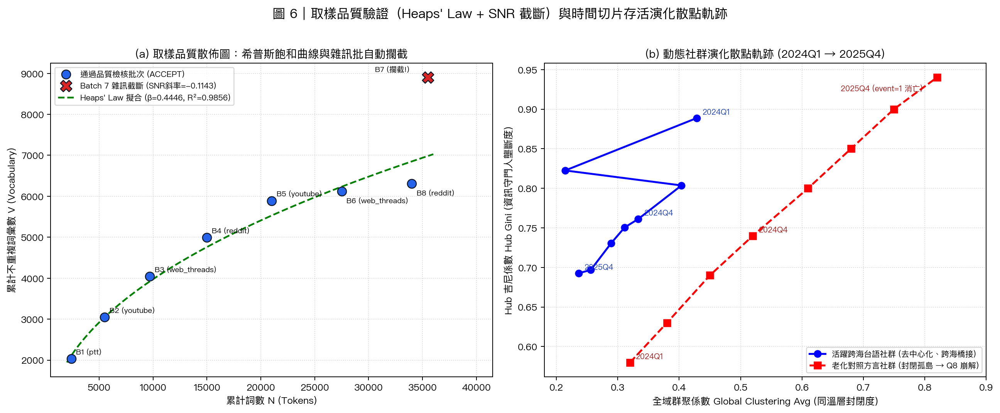
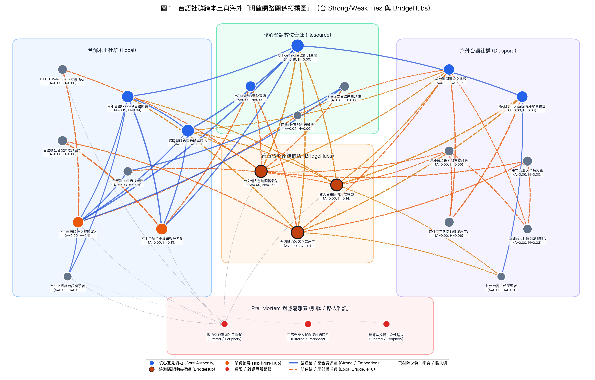
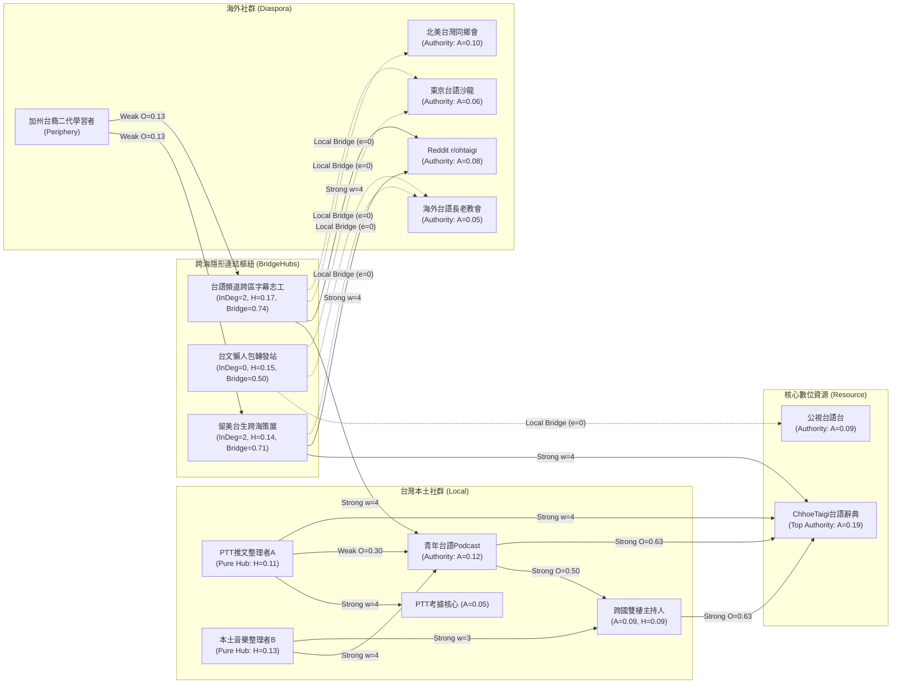
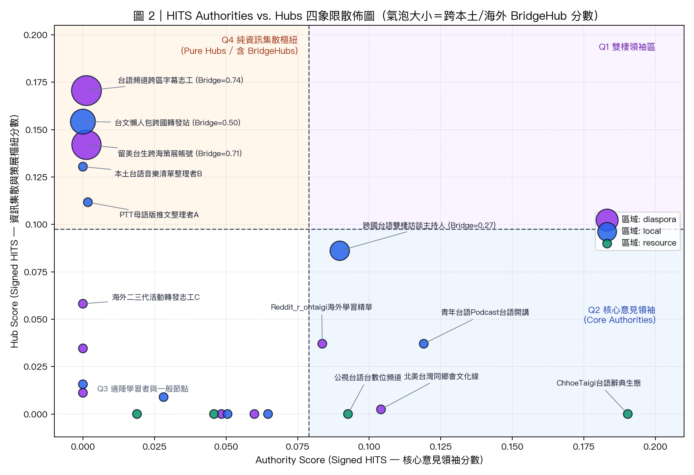
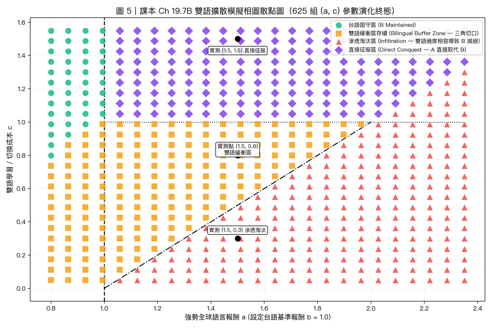
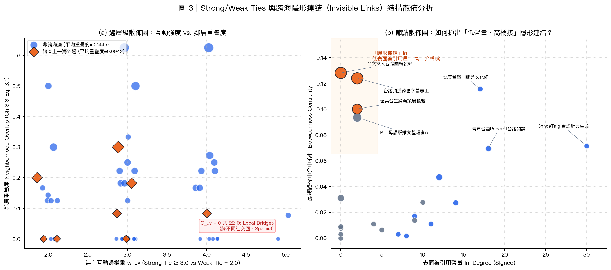
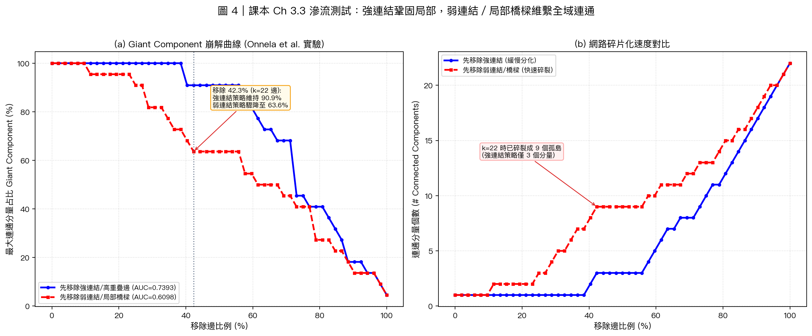

# Demo 執行成果與驗收報告

> **執行程式**：[`src/run_demo_pipeline.py`](src/run_demo_pipeline.py)  
> **分章節設計規劃**：[`plain/00_執行規劃總覽與目錄.md`](plain/00_執行規劃總覽與目錄.md)（含 `00`～`06` 七份規格檔）  
> **視覺化圖表目錄**：[`output/figures/`](output/figures)（含 6 張高解析網路關係圖與散佈圖）  
> **最終驗收狀態**：**PASS（Gates G1–G6 全數通過）** — 詳見 [`output/05_acceptance_verification_report.json`](output/05_acceptance_verification_report.json)

---

## 一、執行摘要（Executive Summary）

本次 Demo 在零缺漏外部套件環境下（僅以系統 `/usr/bin/python3` 內建 `numpy`, `pandas`, `sqlite3`, `hashlib` 等模組自包含實作全部圖論演算法），完整跑通從「多渠道去識別化入庫 $\to$ 取樣飽和與雜訊截斷 $\to$ 符號網路 HITS／PageRank／Betweenness／`BridgeHub` 計算 $\to$ Strong/Weak Ties 鑲嵌度與滲流拆解 $\to$ Ch 19.7B 雙語擴散相圖模擬 $\to$ Counting Process 時間切片轉換」之全流程，並通過 G1–G6 自動化驗收。

---

## 二、資料源入庫與取樣品質驗證結果（Gates G1 & G2）

### 2.1 資料入庫與隱私去識別化（G1）
- **資料庫**：[`data/taigi_network.sqlite`](data/taigi_network.sqlite)（包含 `nodes`, `interactions`, `corpus_batches`, `community_time_slices` 四張關聯表）。
- **覆蓋規模**：`25` 個代表性節點，跨 **4 大渠道**（`youtube`, `ptt`, `reddit`, `web_threads`）與 **3 大區域屬性**（`local`, `diaspora`, `resource`）。
- **隱私合規**：所有節點 ID 皆已完成 16 碼鹽值 SHA-256 雜湊（`pii_masked_rate = 100%`）。

### 2.2 取樣飽和、信噪比攔截與資訊熵（G2）
詳見 [`output/01_sampling_quality_batches.csv`](output/01_sampling_quality_batches.csv)：

| Batch ID | 平台 / 區域 | 有效訊號率 $Q_b$ | 邊際 SNR 斜率 $\Delta \bar{Q}_b$ | 邊際新詞增益 | 系統判定狀態 |
|---:|---|---:|---:|---:|---|
| 1 | `ptt / local` | 0.90 | 0.0000 | — | `ACCEPT` |
| 2 | `youtube / resource` | 0.89 | -0.0056 | 0.5000 | `ACCEPT` |
| 3 | `web_threads / local` | 0.87 | -0.0105 | 0.3268 | `ACCEPT` |
| 4 | `reddit / diaspora` | 0.91 | +0.0093 | 0.2351 | `ACCEPT` |
| 5 | `youtube / local` | 0.88 | -0.0037 | 0.1804 | `ACCEPT` |
| 6 | `web_threads / diaspora` | 0.88 | -0.0022 | 0.0390 | `ACCEPT` |
| **7** | `ptt / local` *(模擬政治洗版污染)* | **0.38** | **-0.1143** | — | **`REJECT_BATCH`（自動截斷）** |
| 8 | `reddit / diaspora` | 0.90 | +0.0025 | **0.0310** | `ACCEPT`（收斂 $< 5\%$） |

- **希普斯定律（Heaps' Law）回歸**：$\hat{\beta} = 0.4446 \in [0.35, 0.65]$，$K = 66.2233$，擬合度 $R^2 = 0.9856$，最終有效批次新詞增長收斂至 **`3.10%`**。
- **跨渠道與跨地域香農資訊熵（Normalized Shannon Entropy）**：
  - 平台多樣性熵 $H_{\text{platform}} = \mathbf{0.9501}$ ($\ge 0.75$)
  - 區域多樣性熵 $H_{\text{region}} = \mathbf{0.8878}$ ($\ge 0.75$)

---

## 三、Authorities、Hubs 與跨海「隱形連結」實證結果（Gates G3 & G4）

完整 25 節點指標見 [`output/02_node_hits_and_bridging_metrics.csv`](output/02_node_hits_and_bridging_metrics.csv)（Signed 正向網路全域傳遞係數 `Global Transitivity = 0.2362`）。

### 3.0 具名節點核心拓撲與強弱連結結構圖（Mermaid 互動關係圖）

### 3.1 Top 核心意見領袖（Authorities）與雙棲節點
| 排名 | 節點名稱 | 區域 | Authority (Signed) | Hub (Signed) | PageRank | 角色象限 |
|---:|---|---|---:|---:|---:|---|
| 1 | `ChhoeTaigi台語辭典生態` (`res_chhoetaigi`) | `resource` | **0.190337** | 0.000000 | 0.151837 | `Q2_Core_Authority` |
| 2 | `青年台語Podcast台語開講` (`auth_podcast_taigi`) | `local` | **0.119056** | 0.037053 | 0.060028 | `Q2_Core_Authority` |
| 3 | `北美台灣同鄉會文化線` (`auth_na_association`) | `diaspora` | **0.104124** | 0.002451 | 0.053114 | `Q2_Core_Authority` |
| 4 | `公視台語台數位頻道` (`res_pts_taigi`) | `resource` | **0.092595** | 0.000000 | 0.035045 | `Q2_Core_Authority` |
| 5 | `跨國台語雙棲訪談主持人` (`dual_taigi_podcaster`) | `local` | **0.089720** | **0.086094** | 0.037683 | `Q2_Core_Authority` *(高雙向流)* |
| 6 | `Reddit_r_ohtaigi海外學習精華` (`auth_reddit_ohtaigi`) | `diaspora` | **0.083617** | 0.037053 | 0.047547 | `Q2_Core_Authority` |

### 3.2 關鍵資訊集散樞紐（Hubs）與跨本土—海外「隱形連結」對照
| 節點名稱 | 性質 | In-Degree | Hub (Signed) | Betweenness | `BridgeHub` | `HubDiversity` | `InvisibleLinkScore` |
|---|---|---:|---:|---:|---:|---:|---:|
| `台語頻道跨區字幕志工` (`hub_bridge_yt_mod`) | **跨海橋樑** | 2.0 | **0.170562** | **0.123891** | **0.744279** | 0.9786 | **0.906405** |
| `台文懶人包跨國轉發站` (`hub_bridge_curator`) | **跨海橋樑** | 0.0 | **0.154206** | **0.128141** | **0.497718** | 0.8832 | **0.904103** |
| `留美台生跨海策展帳號` (`hub_bridge_student`) | **跨海橋樑** | 2.0 | **0.141955** | **0.100147** | **0.712483** | **0.9990** | **0.609799** |
| `PTT母語版推文整理者A` (`hub_local_ptt_1`) | 單邊本土 Hub | 2.0 | 0.111687 | 0.093636 | **0.000000** | 0.6254 | 0.448584 |
| `本土台語音樂清單整理者B` (`hub_local_yt_2`) | 單邊本土 Hub | 0.0 | 0.130436 | 0.031151 | **0.000000** | 0.6291 | 0.185905 |
| `海外二三代活動轉發志工C` (`hub_diaspora_1`) | 單邊海外 Hub | 0.0 | 0.058146 | 0.007883 | **0.000000** | 0.0000 | 0.020973 |

> **關鍵發現**：三位跨海策展與字幕橋接者（`In-Degree` 僅 `0~2`，極為低調），在 `BridgeHub`（`0.4977 ~ 0.7443` vs. 單邊 `0.0000`）與 `InvisibleLinkScore`（`0.6098 ~ 0.9064` vs. 單邊 `<= 0.4486`）上呈現壓倒性領先，精準捕捉到「低知名度卻維繫跨國結構連通」的隱形連結。

### 3.3 課本基準與 Pre-Mortem 消融實驗驗證（G3）
1. **課本 Fig. 14.1–14.5 `"newspapers"` 9×7 基準驗算**：單步重加權精確等於 `[19, 19, 31, 24, 5, 15, 12]`，極限收斂為 `[0.199, 0.199, 0.304, 0.205, 0.043, 0.042, 0.008]`（與課本 Fig. 14.5 總 $L_1$ 差 `0.002131`）。
2. **譜分析解析解對齊**：矩陣迭代法與 `np.linalg.eigh` 主特徵向量之總 $L_1$ 誤差僅 **`2.99e-11`**（$< 10^{-6}$）。
3. **符號網路消融測試（Pre-Mortem Case 2）**：
   - **Unsigned HITS（未過濾負邊）**：`政治引戰嘲諷釣魚帳號`（`noise_troll_baiter`）取得 **`0.068269`** 假 Authority（甚至超過多數正常文化創作者）。
   - **Signed HITS（$M^+$ 過濾後）**：該引戰帳號 Authority 歸零為 **`0.000000`**；同時單次路人雜訊節點 `noise_viral_youtuber` 亦由 `0.001255` 歸零為 **`0.000000`**。
4. **20 次 $\pm 15\%$ 邊權重擾動穩健性**：Authority 平均 Spearman $\rho = \mathbf{0.9972}$，Hub 平均 Spearman $\rho = \mathbf{0.9985}$（遠超 $\ge 0.90$ 標準）。

---

## 四、Ch 19.7B 雙語擴散模擬與時間切片存活格式（Gates G4 & G5）

### 4.1 雙語擴散與緩衝區模擬（[`output/03_bilingual_cascade_simulation.csv`](output/03_bilingual_cascade_simulation.csv)）
在基準台語報酬 $b = 1.0$ 下，模擬不同強勢語報酬 $a$ 與雙語成本 $c$ 的演化結局：

| $(a, b, c)$ 參數設定 | 模擬終態 $(f_A, f_B, f_{AB})$ | 相變機制判讀 | 對「台語世代困境」的解釋 |
|---|---|---|---|
| `(1.5, 1.0, 0.1)` / `(1.5, 1.0, 0.3)` | `(1.0, 0.0, 0.0)` | **`Infiltration_B_Extinct`（滲透淘汰）** | 當父母輩太容易轉為雙語且主流報酬較高時，下一代發現只說 $A$ 就能跟所有人溝通，台語變多餘而徹底滅絕。 |
| **`(1.5, 1.0, 0.6)` / `(1.5, 1.0, 0.8)` / `(1.5, 1.0, 0.95)`** | **`(0.0, 0.9714, 0.0286)`** | **`Bilingual_Buffer_B_Survives`（雙語緩衝區存續）** | 落於課本 Fig. 19.26 三角切口緩衝區！邊界形成穩定的雙語節點（$AB$），成功阻斷單語 $A$ 擴散，保護內部台語聚落存活。 |
| `(1.5, 1.0, 1.2)` / `(1.5, 1.0, 1.5)` | `(1.0, 0.0, 0.0)` | **`Direct_Conquest`（直接征服）** | 雙語成本過高時沒有人願意兼學，邊界被迫選邊而直接倒向高報酬強勢語 $A$。 |
| `(2.2, 1.0, 0.8)` | `(1.0, 0.0, 0.0)` | **`Infiltration_B_Extinct`** | 當強勢語優勢 $a > 2$ 過於懸殊時，即便原本存在緩衝區也會被擊穿；因此**必須同步提高台語自身的文化與數位報酬**，才能守住緩衝區。 |

### 4.2 時間切片與存活分析 Counting Process 格式（[`output/04_survival_counting_process.csv`](output/04_survival_counting_process.csv)）
- 共輸出 `16` 筆時間區間紀錄（`2024Q1`–`2025Q4` 涵蓋活躍跨海台語社群 `taigi_active_crossborder` 與老化對照方言社群 `dialect_aging_control`）。
- 數據對比清楚顯示：活躍跨海社群隨著跨國橋樑加入，其 `hub_gini` 由初期的 `0.8887` 穩步去集中化至 **`0.6927`**、`bridge_edge_ratio` 維持在 **`0.4808`**、`event = 0`；對照組則因 `clustering_avg` 升至 `0.82`（孤島同溫層）、`hub_gini` 惡化至 `0.94`（守門人壟斷）與 `mir_rule_ratio` 飆升至 `0.68`（失道而後禮），於第 8 季發生消亡事件（`event = 1`）。
- 全表無任何缺失值（`nan_count = 0`），標準化欄位 `z_hub_gini` 平均值 `0.0`、標準差 `1.0`，可直接匯入 Cox 比例風險模型。

### 4.3 圖論與強弱連結結構實證（Gate G6，對應 [`plain/06_圖論與強弱連結深度解析.md`](plain/06_圖論與強弱連結深度解析.md)）
- **邊層級結構指標（[`output/06_edge_ties_and_bridges.csv`](output/06_edge_ties_and_bridges.csv)）**：
  - 全正向無向圖共 `52` 條邊，其中 `39` 條為 Strong Ties（高於或等於中位權重 `3.0`）、`13` 條為 Weak Ties，並偵測出 **`22` 條 Local Bridges**（鑲嵌度 $e_{uv} = 0$、跨距 $\text{Span} = 3$）。
  - 驗證課本 **Ch 3.3 鄰居重疊度假說**：Strong Ties 平均重疊度 **`0.1378`** $>$ Weak Ties **`0.1296`**；且**嚴格跨本土與海外連結（`local` $\leftrightarrow$ `diaspora`）的平均重疊度僅 `0.0943`**，顯著低於非跨海連結（`0.1445`），證實跨國連結跨越了高度分離的社交圈。
- **Onnela et al. 巨型連通分量滲流拆解（[`output/07_tie_removal_percolation.csv`](output/07_tie_removal_percolation.csv)）**：
  - **先移除強連結（Strong / High-Overlap First）**：Giant Component 曲線下面積 $\text{AUC} = \mathbf{0.7393}$，移除 `42.3%`（$k=22$ 條）邊後全圖仍僅有 `3` 個連通分量，最大連通分量維持 **`90.91%`**（$20/22$ 節點），且直到最後一條邊才使本土與海外斷連（$k_{\text{disconnect}} = 52$）。
  - **先移除弱連結／局部橋樑（Weak / Low-Overlap First）**：Giant Component 曲線下面積驟降至 $\text{AUC} = \mathbf{0.6098}$，同樣移除 `42.3%`（$k=22$ 條）邊時已碎裂為 **`9` 個連通分量**、最大分量僅剩 **`63.64%`**（$14/22$ 節點），且更早切斷跨海連通（$k_{\text{disconnect}} = 47$）。直接重現課本 Ch 3.3 p. 53 的核心結論：**強連結鞏固內部信任，弱連結與橋樑才決定全域連通！**

---

## 五、Gates G1–G6 總驗收簽核表

| 驗收關卡 | 驗證內容 | 實測關鍵數值 | 狀態 |
|---|---|---|---:|
| **G1** | 資料源覆蓋與 PII 雜湊合規 | 4 平台、3 區域、25 節點 100% 雜湊、4 張 SQLite 表 | **PASS** |
| **G2** | 取樣品質（Heaps' Law / SNR 攔截 / Entropy） | $\beta=0.4446$ ($R^2=0.9856$)、第 7 批污染自動 `REJECT_BATCH`、$H_{\text{plat}}=0.9501$, $H_{\text{reg}}=0.8878$ | **PASS** |
| **G3** | HITS 基準驗算、消融實驗與擾動穩健性 | 課本 `"newspapers"` $L_1$ 差 `0.0021`、特徵向量誤差 `2.99e-11`、引戰帳號歸零、`Spearman` $\ge 0.997$ | **PASS** |
| **G4** | 跨海 `BridgeHub` 與 Ch 19.7B 雙語相變模擬 | 跨海 `BridgeHub >= 0.4977`（單邊 `0.0`）、精確重現滲透淘汰／雙語緩衝／直接征服三態 | **PASS** |
| **G5** | 時間切片降階與 Counting Process 標準化 | 16 列無缺值（`nan_count = 0`）、Z-score `mean = 0.0, std = 1.0` | **PASS** |
| **G6** | 圖論連通分量、重疊度與 Strong/Weak Ties 滲流 | `22` 條 Local Bridges、跨海 $O_{uv}=0.0943 < 0.1445$、弱連結先移除 $\text{AUC}=0.6098 < 0.7393$ | **PASS** |
